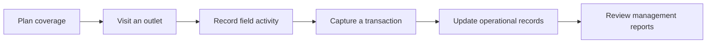

# RouteCRM

**Field-sales execution and distribution visibility, designed around real route-to-market operations.**

> **Public product overview only.** The application source code is maintained in a separate **private repository**. This showcase does not contain operational data, customer records, credentials, deployment configurations, or internal commercial information.

## The problem

Field-sales businesses often have to reconcile outlet lists, visit records, rep activities, orders, stock movements, and management reports across disconnected tools. What seems simple on a dashboard becomes more complicated when people are moving between outlets, network connections are unreliable, and the same inventory must remain accurate across transactions.

RouteCRM is an effort to bring these workflows into one coherent operating system for distribution teams.

## What the product covers

| Area | Purpose |
| --- | --- |
| **Outlets and territories** | Organize outlet records, field routes, and coverage assignments |
| **Field visits** | Record outlet visits and field activity, with location-aware workflows |
| **Sales execution** | Capture rep-level transactions and product-level activity |
| **Inventory** | Track stock movements and transaction-level inventory effects |
| **Receivables and remittances** | Support the operational follow-through from sale to collection |
| **Targets and reporting** | Help managers understand execution, coverage, and performance |
| **Management workflows** | Support route planning, imports, and administrative oversight |

The exact feature set is evolving through internal testing and pilot preparation.

## Typical operating flow

## Technology and engineering approach

The private application is being developed with a **Python/FastAPI backend**, **SQLAlchemy and Alembic**, **PostgreSQL**, **Docker**, and a **React Native mobile application**. Reporting work includes **SQL-based analytics and Metabase**.

Key engineering priorities include:

- Data integrity across stock and sales workflows
- Appropriate isolation between customer organizations
- Controlled authorization and access to operational data
- Resilience to unreliable mobile connectivity
- Repeatable migrations, testing, and safe deployment practices
- Useful monitoring and recoverable failure handling

These are **development priorities**, not a claim of a completed external security audit or an unrestricted production release.

## Project status

**Active private development — commercial pilot preparation and validation.** Features, screenshots, demonstrations, and deployment details will be shared publicly only when appropriate and sanitized.

## Why the source is private

RouteCRM is a commercial product initiative. Keeping its working codebase private during development allows the public showcase to focus on product design and engineering lessons without exposing proprietary implementation details or information belonging to pilot participants.

## Creator

**Desmond Adedosu** — FMCG commercial operations professional and backend-focused product builder.

[GitHub profile](https://github.com/adekunlewriteswell-code)
